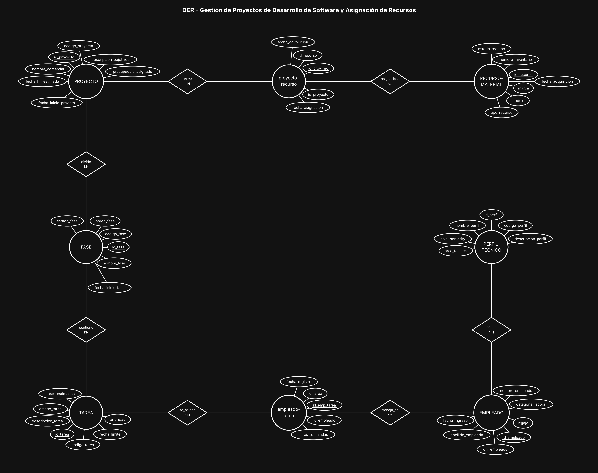
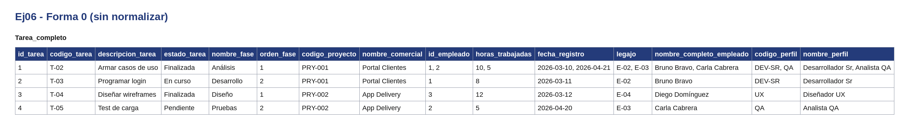
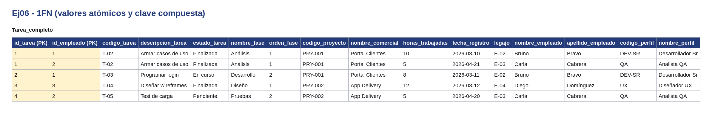
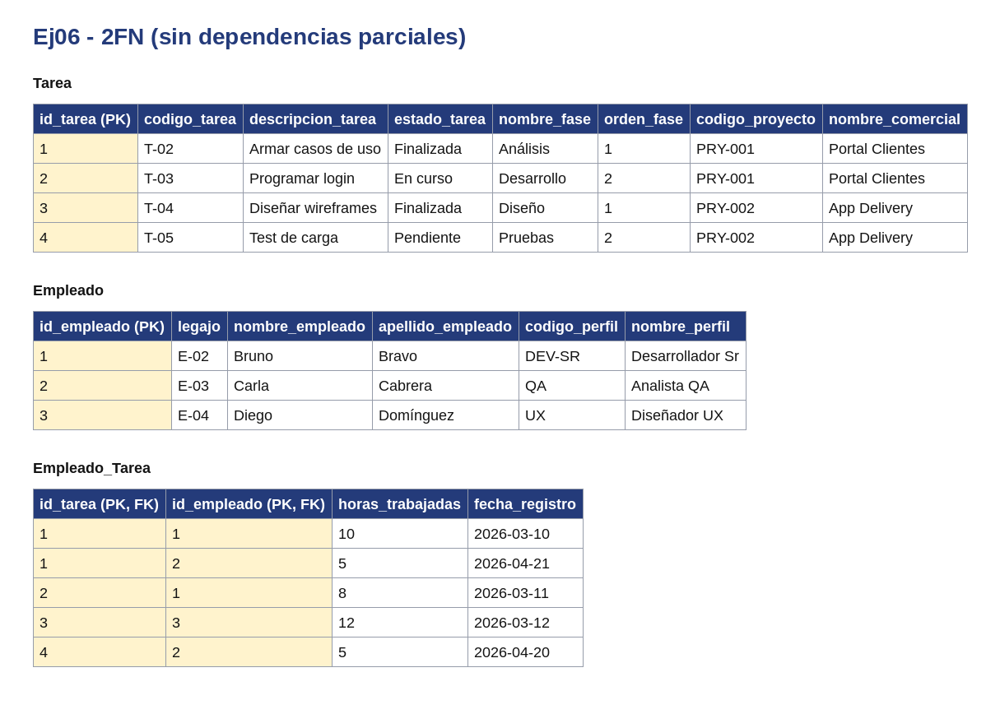
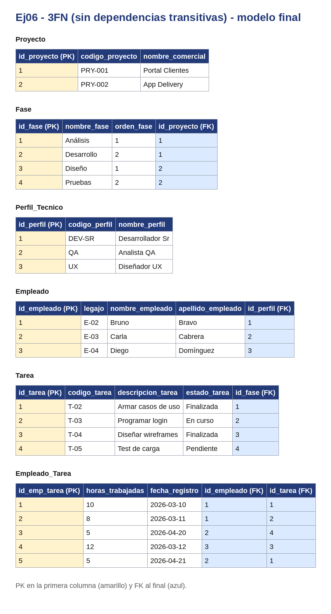

# BaseDeDatos-U1-Ej06-GestionProyectos

Base de Datos - Unidad 1 - Ejercicio 6

## Consigna

Modelar el sistema interno de una consultora de software: proyectos descompuestos en fases y tareas, empleados con perfil técnico que ejecutan esas tareas registrando horas reales trabajadas, y recursos materiales (hardware y software) asignados temporalmente a los proyectos.

## Lógica

**Jerarquía PROYECTO → FASE → TAREA (composición 1:N encadenada).** La fase no existe sin su proyecto y la tarea no existe sin su fase: son dependencias de existencia. La tarea se cuelga de la fase y no directamente del proyecto porque la consigna dice que cada fase contiene su conjunto de tareas; el proyecto llega a sus tareas por transitividad, sin necesidad de una FK redundante `id_proyecto` en TAREA (eso permitiría inconsistencias donde la tarea apunta a un proyecto distinto al de su fase).

**PERFIL-TECNICO como entidad, no como atributo de EMPLEADO.** El enunciado da ejemplos cerrados (Backend, UX, Tester QA, DevOps), o sea un catálogo finito y reutilizable. Como entidad se evita repetir el texto en cada empleado y se puede filtrar por perfil al asignar recursos humanos. Cardinalidad PERFIL 1:N EMPLEADO porque el enunciado habla de un perfil **principal**: cada empleado tiene uno solo.

**Empleado ↔ Tarea: N:M resuelta con `empleado-tarea`.** Un empleado trabaja en varias tareas y una tarea puede tener varios empleados según su complejidad. `horas_trabajadas` va en la intermedia porque no es un dato del empleado (trabaja distinta cantidad en cada tarea) ni de la tarea (cada empleado aporta distinto): es un atributo del hecho de la asignación. Con `fecha_registro` además se puede auditar la carga de horas.

**Proyecto ↔ Recurso: N:M con `proyecto-recurso`.** La clave está en la palabra "temporalmente": un mismo equipo o licencia se presta a un proyecto, se libera y después va a otro. Si fuera N:1 (recurso con una sola FK de proyecto) se perdería el histórico de asignaciones al reasignarlo. Por eso la intermedia guarda `fecha_asignacion` y `fecha_devolucion`, que delimitan el período de uso.

**Integridad referencial.** Cada entidad tiene PK propia subrayada con la convención `id_<entidad>` (`id_proyecto`, `id_fase`, `id_tarea`, `id_empleado`, `id_perfil`, `id_recurso`); los códigos de negocio (`codigo_proyecto`, `legajo`, `numero_inventario`) quedan como atributos con UNIQUE. Las intermedias llevan ID propio más las dos FK, sobre las que conviene declarar un UNIQUE compuesto para evitar duplicados (un empleado cargado dos veces en la misma tarea). Los borrados en cascada aplican hacia abajo en la jerarquía (borrar un proyecto arrastra fases y tareas), mientras que la baja de un empleado o un recurso debería restringirse mientras tenga registros en las intermedias, para no perder las horas ya imputadas.

**Convención de claves.** Toda entidad lleva como PK un identificador propio `id_<entidad>` (subrayado en el diagrama) y al menos 5 atributos además del id; el código o documento de negocio (`dni`, `codigo_*`, `legajo`, etc.) queda como atributo común con restricción UNIQUE. Las entidades intermedias de las relaciones N:M llevan los tres ids: el propio y las dos FK de las entidades que unen (UNIQUE compuesto sobre ambas FK).

## Resultado

---

## Normalización

Se normaliza el documento `Tarea` con sus registros de `Empleado_Tarea`. En todas las tablas la PK va en la primera columna y las FK al final. Los datos son de ejemplo.

**Forma 0.** Una sola tabla con todo junto. Hay celdas con listas: cada tarea puede tener varios registros de empleado tarea, y los nombres vienen completos en una sola columna.

**1FN.** Se separan nombre y apellido. Cada elemento de la lista pasa a su propia fila y la clave queda compuesta: (`id_tarea`, `id_empleado`).

**2FN.** Los datos de tarea dependen solo de `id_tarea` y los de empleado solo de `id_empleado`. Se separan en `Tarea` y `Empleado`; `Empleado_Tarea` queda con la clave compuesta y lo que depende de ambos.

**3FN.** Los datos de `Fase`, `Proyecto` y `Perfil_Tecnico` dependen de su propio identificador y no de la PK de tarea, así que pasan a tablas aparte. En el modelo final cada tabla usa su id propio.

Para que se vea la lista en la Forma 0, se agregó un registro de ejemplo en `Empleado_Tarea` para el tarea 1.

---

## SQL

El script `script.sql` crea las tablas con sus claves primarias y foráneas y carga datos de ejemplo. Está probado en SQLite (con `PRAGMA foreign_keys = ON;`).
